# Zany Test Prep

An **offline-first, Duolingo-style SAT & ACT prep app** built in Flutter. Short
5–15 minute challenge lessons, gamified progression (XP, levels, streaks,
mastery, badges, crowns), full-length timed practice tests, and a spaced review
system — all working **completely offline after install**. No backend, no login,
no network.

- **Platform:** Android-first, architected cross-platform (iOS/web/desktop ready).
- **Exams:** pick the **SAT** or the **ACT** at onboarding and switch any time in
  Settings (XP, streaks and rewards carry across; each exam keeps its own path).
- **Content:** every question is original and generated from a library of
  **question families** — many distinct forms per skill, mixed within each lesson
  so nothing feels like one template with new numbers.
  - SAT: 117 lessons, 31,177 questions
    (15,192 Math, 15,985 Reading & Writing).
  - ACT: 147 lessons, 21,645 questions
    (6,753 English, 13,032 Math, 360 Reading,
    1,500 Science), with 5-choice Math and NO CHANGE-style English.
  - No copyrighted College Board or ACT, Inc. material.
- **Stack:** Flutter (stable, 3.35.5), Material 3, Riverpod, GoRouter,
  `shared_preferences` persistence.

> The data model is **exam-agnostic** (`exam_id`/`domain`/`section`/`skill`/…)
> and the UI reads domains, test layout and score scales from each exam's
> descriptor, so AP exams can be added with content alone.

## Screenshots

| Onboarding | Home / Path | Teaching card | Question |
| --- | --- | --- | --- |
| 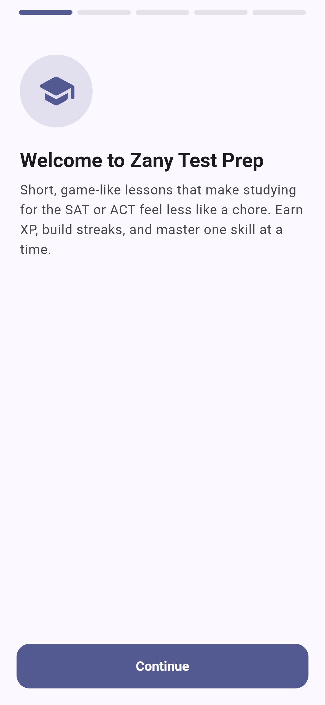 | 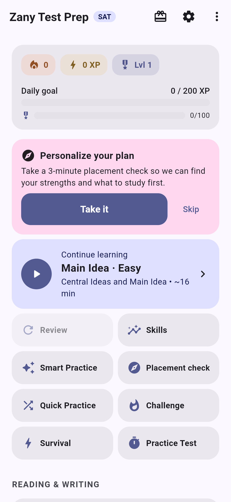 | 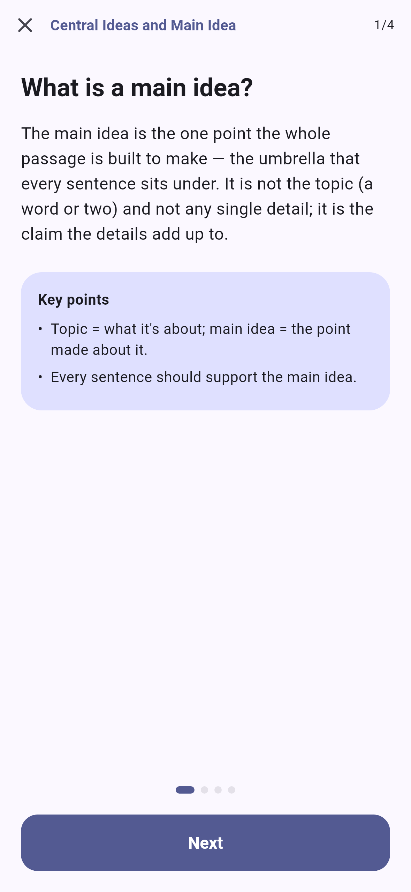 | 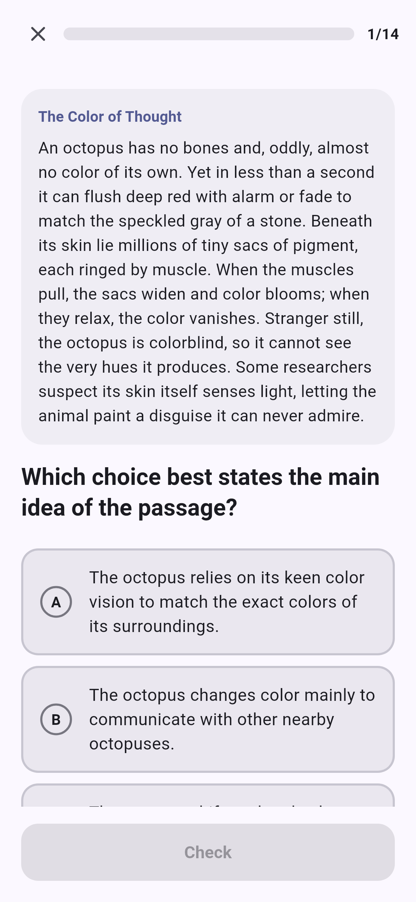 |

| Instant feedback | Lesson complete | Achievements | Progress dashboard |
| --- | --- | --- | --- |
| 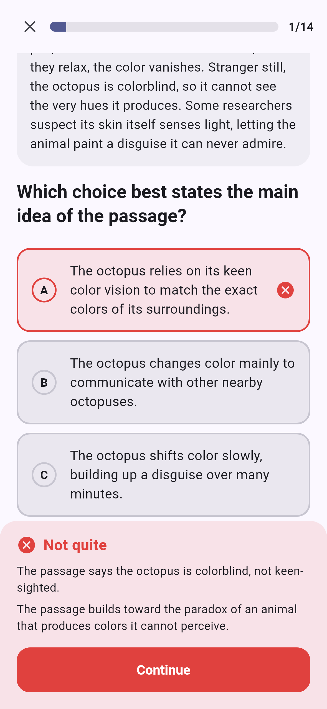 | 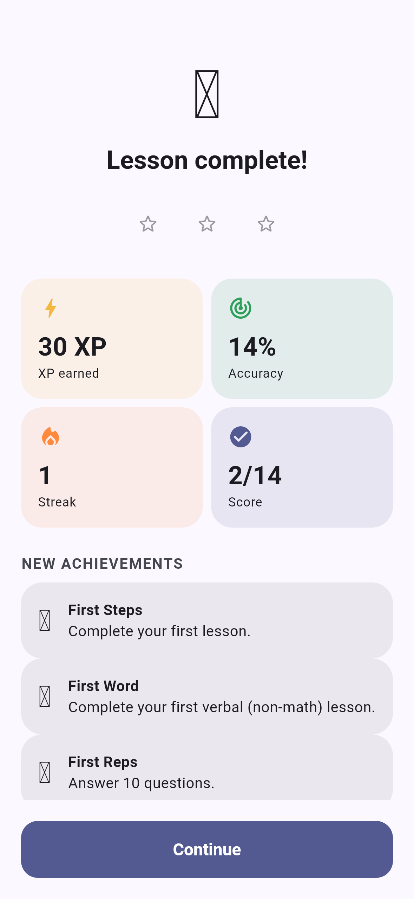 | 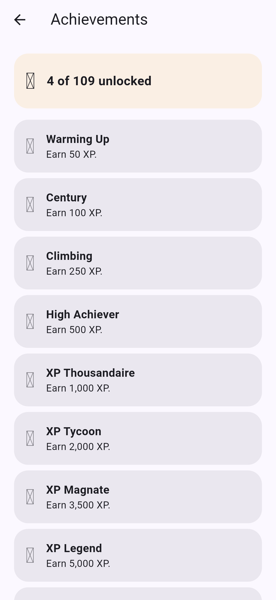 | 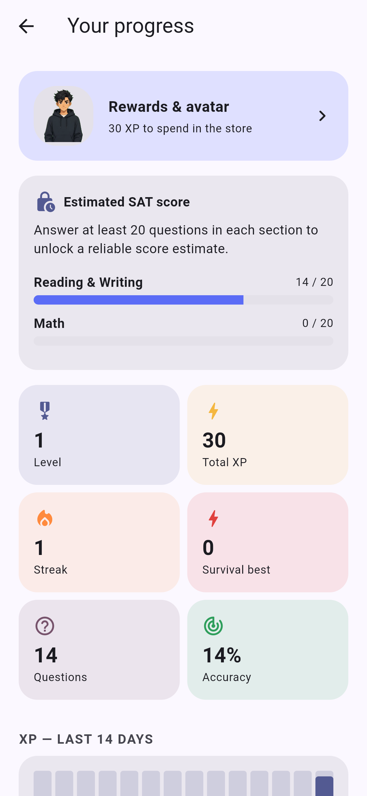 |

| Rewards hub | Chest reward | Store | Customize |
| --- | --- | --- | --- |
| 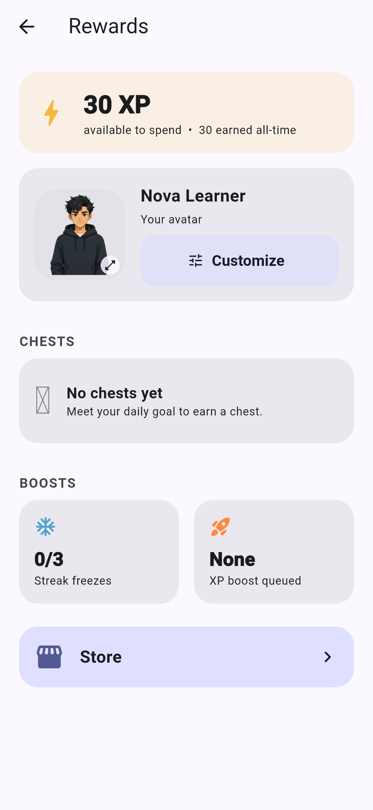 | 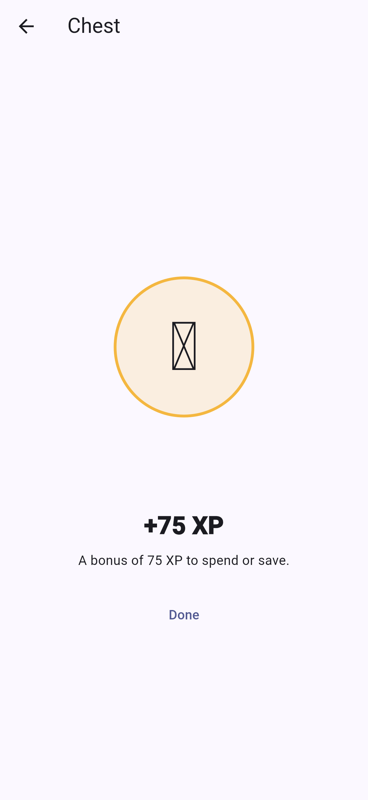 | 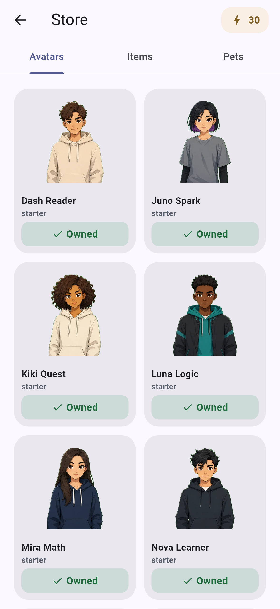 | 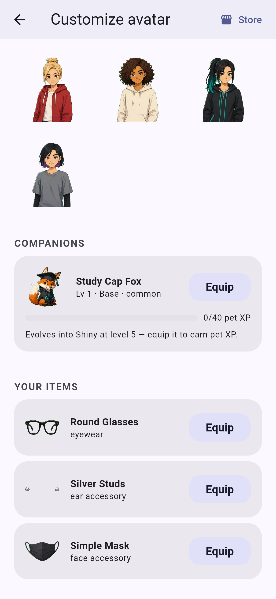 |

### Avatar customization & pet companions

Meet the daily goal to earn chests, spend XP in the store, then dress up a
customizable avatar from the vendored art pack (110 avatars, 272 items including
64 Prism variants, 90 pet lines; hats are hidden for now until their art is
redrawn). Glasses, masks and earrings are fitted to each avatar's own face (every
avatar's eyes, nose and ears are measured), and the four side slots hold pets and
floating props. Tap the avatar to see it full screen. The store and customizer
filter by item type and rarity, and sort by price, rarity or name.
**Pets level up while equipped** and evolve from Base to Shiny to Radiant forms
(270 pet sprites in all); evolved stages are earned, never bought. Here's one
avatar built up layer by layer, plus a couple of other looks:

| Starter | + Earrings | + Glasses | + Scarf & badge |
| --- | --- | --- | --- |
| 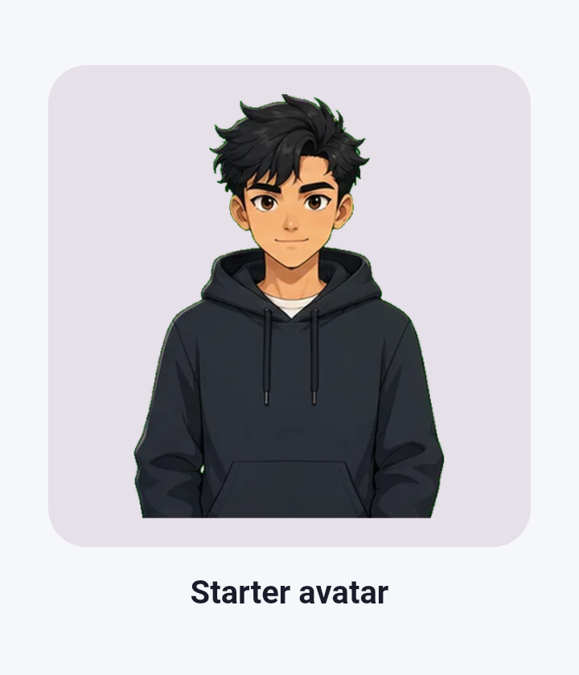 | 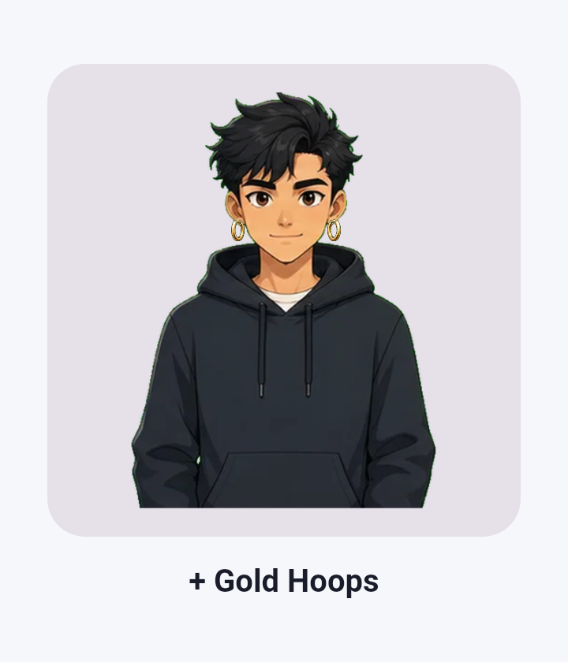 |  |  |

| Full look + pet | Another avatar | Two side slots |
| --- | --- | --- |
|  | 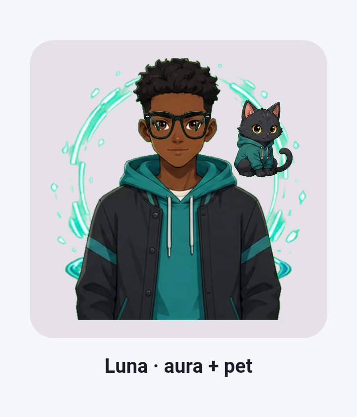 | 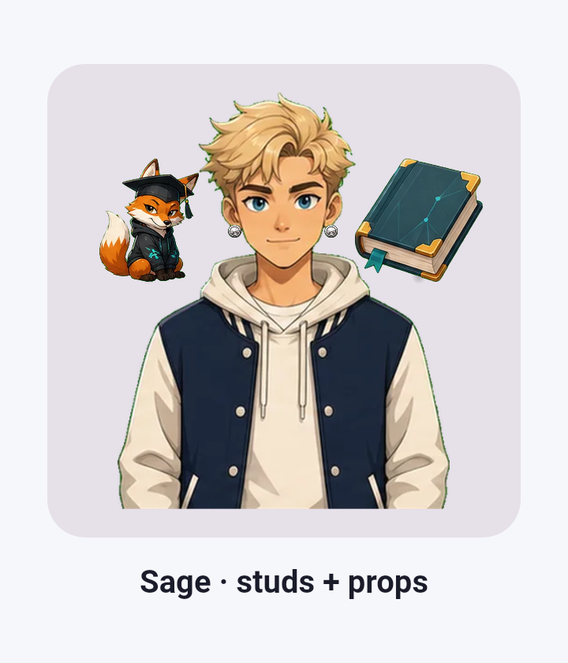 |

> Screenshots are generated headlessly from the real app via
> `flutter test --tags screenshots` (see `test/screenshots/`).

## Quick start

The whole toolchain is isolated to this repo. A [mamba](https://mamba.readthedocs.io/)
environment (`zany-test-prep`) provides JDK 17 + Python content tooling, and the
Flutter SDK + Android SDK are installed into a git-ignored `.tooling/` directory.

```bash
# 1. One-time setup: mamba env + Flutter 3.35.5 + Android SDK into .tooling/
bash scripts/setup_env.sh

# 2. Every shell: put flutter/dart/java/sdkmanager on PATH
source scripts/activate.sh

# 3. Sanity check the toolchain
flutter doctor

# 4. Run the app (device/emulator attached)
flutter run
```

If you already have a working Flutter + JDK 17 + Android SDK on your machine, you
can skip `setup_env.sh`/`activate.sh` and use your own toolchain.

## Common commands

```bash
# Validate the offline content banks (schema + referential + answer + variety checks)
python tools/validate_content.py

# Regenerate the canonical content JSON under content/exams/{sat,act}/
python tools/generate_content.py            # or --exam act

# Rebuild the app asset bundles (assets/content/*.bundle.json + exams.json);
# --bump raises content_version for any exam whose content changed
python tools/build_bundle.py --bump

# Python tooling + generator tests
python -m unittest discover -s tools/tests -t .

# Run unit + widget tests
flutter test

# Run the integration test (launch → onboard → lesson → persist)
flutter test integration_test

# Build a release APK
flutter build apk --release
# -> build/app/outputs/flutter-apk/app-release.apk

# Build a debug APK
flutter build apk --debug
# -> build/app/outputs/flutter-apk/app-debug.apk
```

> The content pipeline order is **generate → validate → bundle**. CI rebuilds the
> bundle and fails if the committed `assets/content/` is stale, so always run
> `python tools/build_bundle.py` and commit the result after changing content.

## Installing on a phone

Download the latest APK from
[Releases](https://github.com/mjcipriano/zany-test-prep/releases/latest), let the
download finish completely, then open it from **Files → Downloads**. See
[docs/install.md](docs/install.md) for step-by-step instructions, an ADB
alternative, troubleshooting (*"problem parsing the package"*), and the Android
developer verification plan.

## Building & shipping an APK

- **Local build:** `flutter build apk --release` produces
  `build/app/outputs/flutter-apk/app-release.apk`. By default this is
  **debug-signed**, which is fine for private/internal distribution.
- **CI artifacts:** GitHub Actions builds and uploads APKs automatically — see
  [docs/release.md](docs/release.md). Debug APKs are produced on every push to
  `master`; release APKs are produced on `v*` tags.
- **Private release:** tag a commit `vX.Y.Z` and push the tag. The Release
  workflow builds a release APK (and a best-effort `.aab`) and attaches it to a
  GitHub Release. Full steps in [docs/release.md](docs/release.md).

## Project structure

```text
.
├── lib/                     # Flutter app source
│   ├── main.dart            # entrypoint
│   ├── app/                 # AppController (Riverpod), GoRouter, root widget
│   ├── domain/
│   │   ├── models/          # exam-agnostic models (question, lesson, profile, progress…)
│   │   └── services/        # game engines (xp/level, streak, mastery, review, unlock, badges…)
│   ├── data/
│   │   ├── local/           # KeyValueStore interface + shared_preferences impl
│   │   └── repositories/    # content + progress repositories
│   ├── design/              # Material 3 theme + shared widgets
│   └── features/            # UI per feature (onboarding, home, lessons, review, …)
├── content/                 # canonical, exam-agnostic content (source of truth)
│   ├── exams/sat/           # exam.yaml, skills.yaml, lessons/, questions/, manifest.json
│   ├── exams/act/           # same layout: english / math / reading / science
│   ├── schemas/             # question.schema.json, lesson.schema.json
│   ├── prompts/             # reusable AI content-generation prompts
│   └── validators/          # validator docs
├── tools/                   # Python content pipeline
│   ├── generate_content.py  # regenerate every exam's bank (walks exam_plans.py)
│   ├── validate_content.py  # schema + referential + answer + variety checks (CI)
│   ├── build_bundle.py      # build assets/content/<exam>.bundle.json + exams.json
│   ├── content_gen/         # question families: math, writing, passages, science, teaching
│   └── tests/               # unittest suite for the tooling + every generator family
├── assets/content/          # built bundles the app loads at runtime (generated)
├── scripts/                 # setup_env.sh, activate.sh
├── .github/workflows/       # ci.yml, android-apk.yml, release.yml
└── docs/                    # this documentation set
```

## Documentation

| Doc | What's inside |
| --- | --- |
| [docs/architecture.md](docs/architecture.md) | App layers, Riverpod state, GoRouter navigation, content loading |
| [docs/content.md](docs/content.md) | Content schemas field-by-field, question types, the pipeline |
| [docs/persistence.md](docs/persistence.md) | Storage keys, JSON shapes, reset behavior, offline guarantees |
| [docs/gamification.md](docs/gamification.md) | XP, levels, streaks, daily goals, mastery, review, badges, crowns — with formulas |
| [docs/content-authoring.md](docs/content-authoring.md) | Question families, per-exam plans, adding a new exam (AP), the workflow |
| [docs/release.md](docs/release.md) | GitHub Actions workflows, cutting a private release, signing secrets |
| [docs/install.md](docs/install.md) | Installing the APK, troubleshooting, Android developer verification |
| [docs/roadmap.md](docs/roadmap.md) | Known limitations and the future roadmap |

## Privacy

The app stores all progress **locally on the device** (via
`shared_preferences`). It has no backend, requires no account, and makes no
network requests. Resetting progress from Settings wipes the local data.

## Content note

All practice content in this repository is **original, SAT- and ACT-style**
material, generated or authored for this project. It contains **no copyrighted
College Board or ACT, Inc. questions** or official test-prep material. "SAT" is a
trademark of the College Board and "ACT" is a trademark of ACT, Inc.; neither is
affiliated with nor endorses this app.
